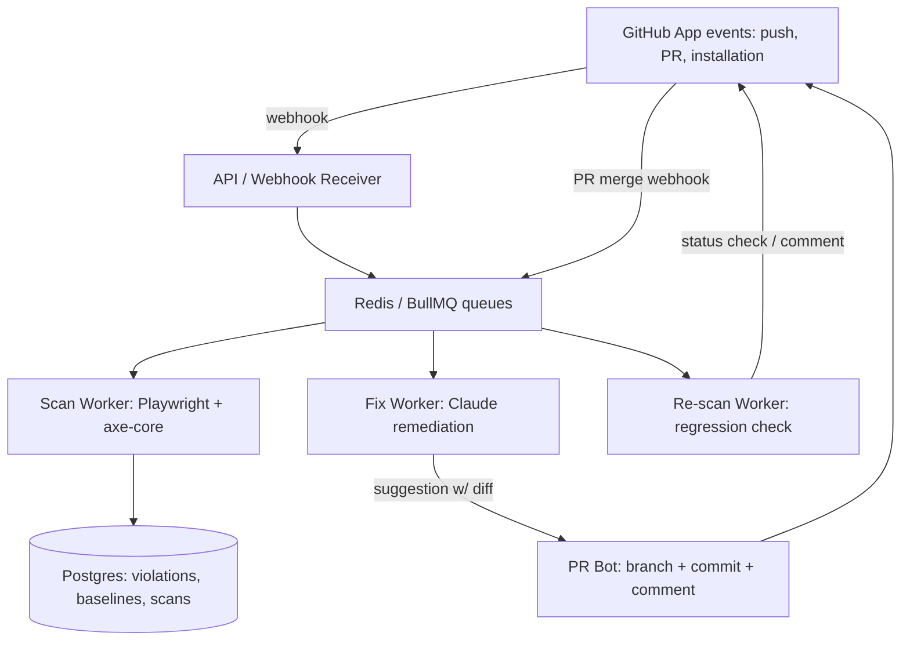

# System Architecture: EAA auto-fix PR bot: scan -> AI Axe-rule fix -> human approves

`75c-eaa-autofix-pr-bot`

---

## 1. Architectural Overview

GitHub App + scan workers + LLM fix generator + PR bot. Event-driven: webhooks enqueue work, workers scan and generate fixes, bot posts PRs. Human in the loop via GitHub PR review.

---

## 2. Component Specifications

### 2.1 GitHub App (integration surface)
- Installed per-org or per-repo; repo-scoped installation tokens.
- Token permissions: `contents:write` (create branches/commits), `pull_requests:write`, `checks:write`. Explicitly **no** merge permission.
- Handles webhooks: push, PR events, installation, check_run.

### 2.2 Scan Worker
- Playwright headless Chromium; inject axe-core; crawl configured URL sets.
- Output: axe violation JSON per page, keyed by rule ID + DOM selector + WCAG/EN 301 549 mapping.
- Dedupes against baseline; only new/unfixed violations trigger fix generation.

### 2.3 Fix Worker (LLM remediation)
- Input: source file + axe violation + rule metadata (axe rule help + WCAG technique).
- Claude Sonnet generates minimal scoped patch constrained to the violating element.
- Patch validator: every diff hunk must reference a detected rule ID; reject otherwise.
- Tier 1 (no LLM): deterministic fixes (missing lang attr, empty alt on decorative img) applied as direct commits to fix branch.

### 2.4 PR Bot
- Creates `eaa-fix/<rule-id>-<slug>` branch per violation group.
- PR body: before/after axe summary, WCAG mapping, screenshot diff, one-click approve instructions.
- Posts as check status (pass/fail) so it integrates with branch protection.

### 2.5 Data & Storage
- Postgres: Installations, Repos, Scans (baseline + history), Violations, FixPRs, AuditLog, Billing.
- Redis: BullMQ queues (scan, fix, re-scan) + rate limits.

### 2.6 Observability & Eval
- OpenTelemetry traces per scan/fix execution.
- Golden-case eval: fixture pages with known violations; CI asserts fixes are correct and in-scope.
- Token cost metering per repo for LLM cost dashboard.

---

## 3. Data Flow

1. Push to main (or scheduled) triggers webhook -> enqueue scan job.
2. Scan worker crawls, runs axe; violations diffed against baseline in Postgres.
3. New violations enqueue fix jobs (respecting per-run LLM cost cap).
4. Fix worker generates patch; validator enforces scope; Playwright re-scan + screenshot.
5. If re-scan shows >= baseline violations and no new issues: PR created w/ results comment.
6. Human reviews, requests changes, or approves + merges.
7. Merge webhook triggers re-scan; regression adds check failure on main.
8. Audit log records every scan/fix/PR action for EAA evidence.

---

## 4. Security & Privacy Architecture

- **Bot token hygiene:** installation token per-request; no repo read beyond changed files; merge permanently disabled.
- **Source code handling:** files fetched per-fix, never persisted beyond session; no training on customer code (LLM providers zero-retention endpoints or in-house for enterprise tier).
- **Circuit breaker on LLM spend** per repo per month w/ hard kill + alert.
- **Prompt-injection defense:** scraped page content treated as untrusted input; stripped/sanitized before LLM context.

---

## 5. Project-Specific Stack

- GitHub App (Probot or raw octokit), TypeScript, Node worker processes.
- Playwright + axe-core for scanning.
- Claude Sonnet for targeted remediation; Haiku for low-value alt text generation.
- Postgres + Redis/BullMQ; Stripe metered billing (per merged fix + per page scanned).

---

## 6. Project-Specific Components

- Scan -> AI-generated axe-rule fix scoped to detected violations
- Fix PR with diff + before/after results + screenshot check
- Human approval gate via GitHub PR review (bot has no merge right)
- Merge-triggered re-scan as GitHub check

---

## 7. Known Failure Modes (defensive design)

- Auto-fix breaks other a11y rules → before/after re-scan on every fix branch; violation regression blocks PR.
- Auto-merge bypasses review → GitHub App token lacks merge permission; approval enforced by GitHub branch protection + check required.
- Fix breaks visual layout → Playwright screenshot diff attached; human sign-off required.
- LLM hallucinates out-of-scope edit → patch validator rejects hunks that don't map to a detected rule ID.
